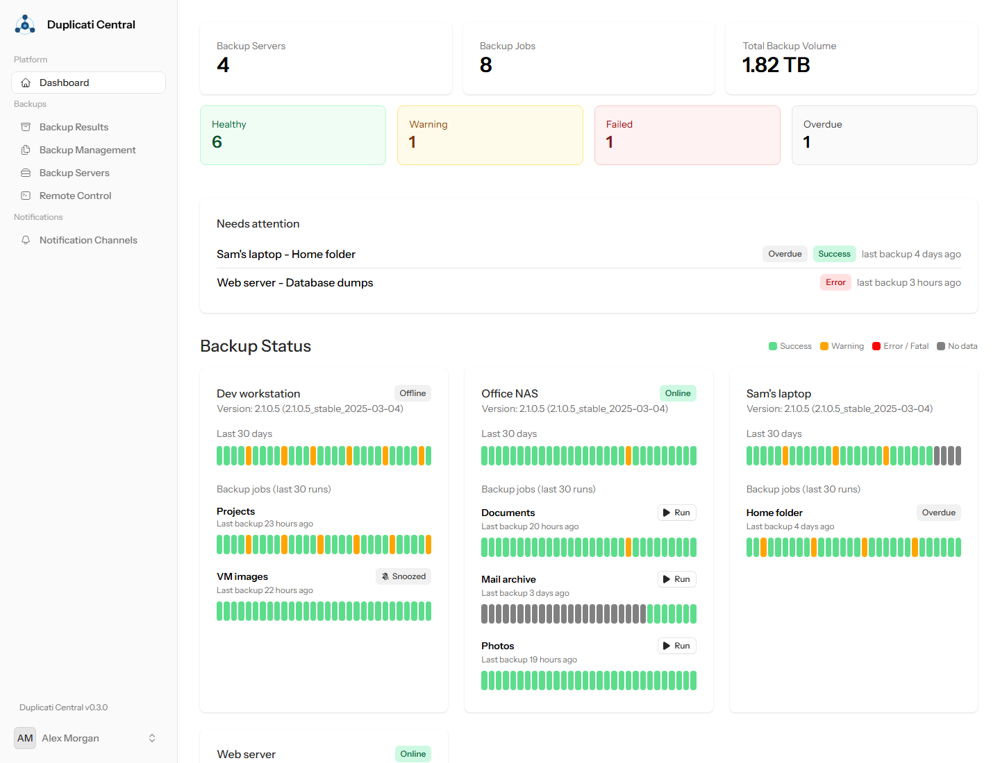
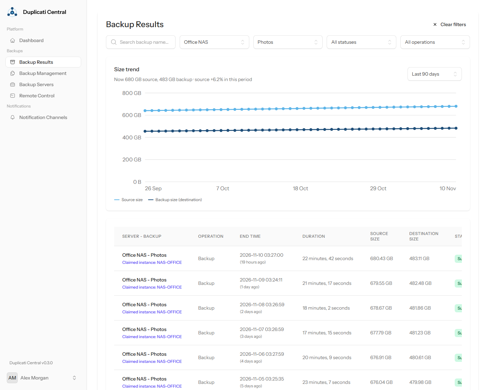
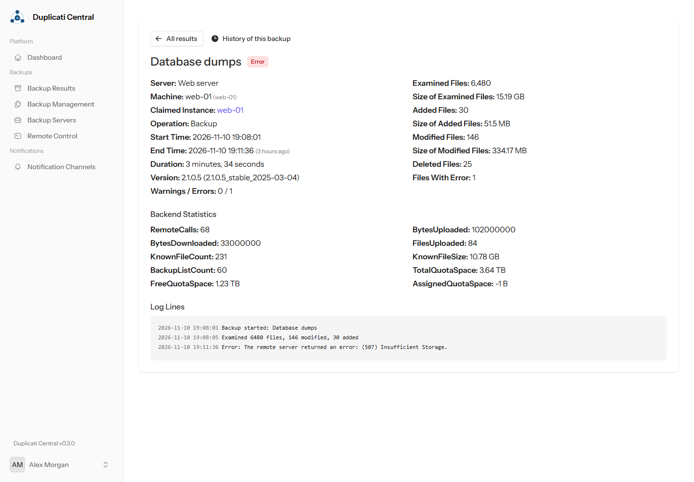
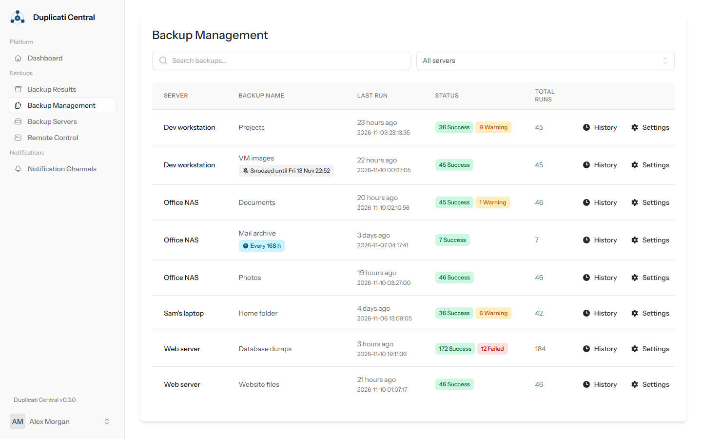
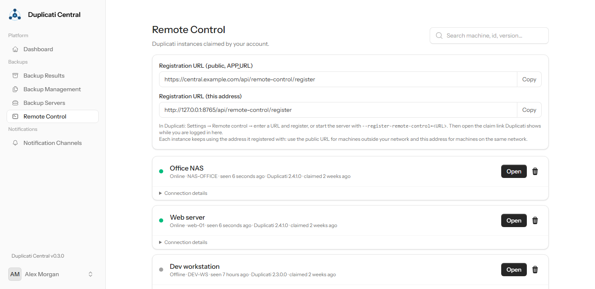
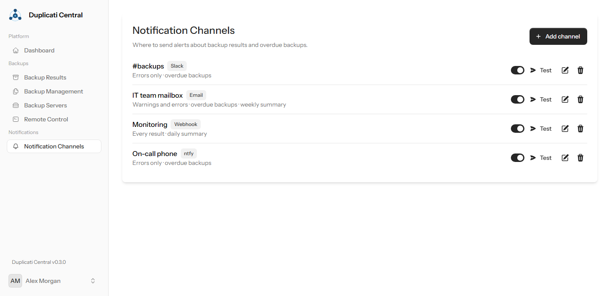
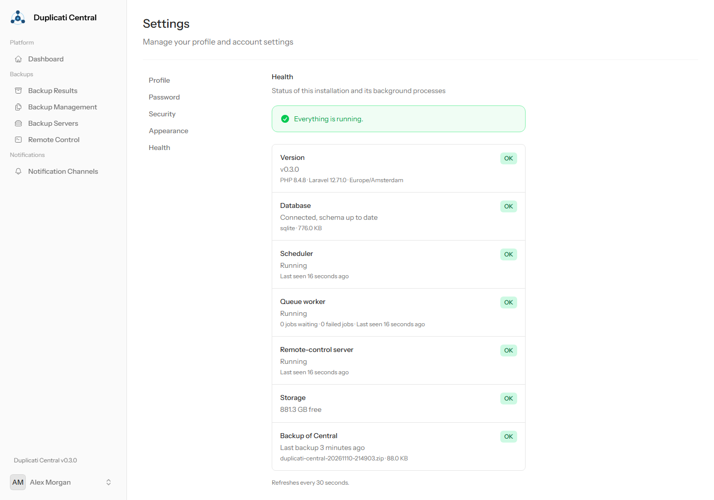

# Duplicati Central

A self-hosted dashboard for your [Duplicati](https://www.duplicati.com/) backups. Every Duplicati instance reports its results to Duplicati Central. You see in one place what ran, what failed and what is overdue, and you get alerts where you want them.

- **Dashboard**: status tiles, a 30-day overview per server, the history of each job and a "Needs attention" list.
- **Missed backups**: learns each job's schedule (or uses the interval you set) and alerts when a backup is overdue.
- **Notifications**: email, Discord, Slack, Microsoft Teams, Telegram, ntfy, Pushover or any webhook. Choose a level per channel (every result, warnings, errors only), plus daily or weekly summaries.
- **Snooze**: mute alerts for a server or a single job, from 1 hour to "until I resume".
- **Results and details**: filter results, read log lines and backend statistics, and see size trends per job.
- **Remote control** (optional): connect instances to run a backup or repair from Central, follow progress live and import past results from the instance's own log. Works with Duplicati 2.3 and 2.4+.
- **Security**: authenticator app (TOTP), passkeys, optional mandatory 2FA, sign-up closed after the first account.
- **Installable app (PWA)** with a failing-jobs badge on the icon.
- **Health page and self-backup**: check that the background processes run, and back up Central itself.

<picture>
  <source media="(prefers-color-scheme: dark)" srcset="docs/screenshots/dashboard-dark.png">
  
</picture>

<table>
  <tr>
    <td width="50%">
      <picture>
        <source media="(prefers-color-scheme: dark)" srcset="docs/screenshots/backup-results-dark.png">
        
      </picture>
      <p align="center">Results and size trend per job</p>
    </td>
    <td width="50%">
      <picture>
        <source media="(prefers-color-scheme: dark)" srcset="docs/screenshots/backup-detail-dark.png">
        
      </picture>
      <p align="center">Details and log lines of a run</p>
    </td>
  </tr>
  <tr>
    <td>
      <picture>
        <source media="(prefers-color-scheme: dark)" srcset="docs/screenshots/backups-dark.png">
        
      </picture>
      <p align="center">All jobs, with snooze and interval settings</p>
    </td>
    <td>
      <picture>
        <source media="(prefers-color-scheme: dark)" srcset="docs/screenshots/remote-control-dark.png">
        
      </picture>
      <p align="center">Remote control of connected instances</p>
    </td>
  </tr>
  <tr>
    <td>
      <picture>
        <source media="(prefers-color-scheme: dark)" srcset="docs/screenshots/notification-channels-dark.png">
        
      </picture>
      <p align="center">Notification channels</p>
    </td>
    <td>
      <picture>
        <source media="(prefers-color-scheme: dark)" srcset="docs/screenshots/health-dark.png">
        
      </picture>
      <p align="center">Health of the installation</p>
    </td>
  </tr>
</table>

<sub>Screenshots show fictional demo data.</sub>

## Quick start (Docker)

```bash
curl -O https://raw.githubusercontent.com/burnacid/Duplicati-Cental/master/docker-compose.yml
curl -o .env https://raw.githubusercontent.com/burnacid/Duplicati-Cental/master/.env.docker.example
# Edit .env: at least APP_URL, and ADMIN_EMAIL / ADMIN_PASSWORD for the first account.
docker compose up -d
```

Open `http://<host>:8181` and sign in. If you did not set `ADMIN_EMAIL`, the first person to open `/register` becomes the admin. After that, sign-up is closed.

Everything (database, encryption key, keys and logs) lives in the `storage` volume. Keep that volume and back it up (see [Backing up Central](#backing-up-central)).

**HTTPS**: passkeys and installing the app need HTTPS. Put Central behind your own reverse proxy (set `TRUSTED_PROXIES`), or let it get a Let's Encrypt certificate itself. See option A in `docker-compose.yml`.

**MySQL/MariaDB**: SQLite is built in and is enough for most setups. Option B in `docker-compose.yml` shows how to use MariaDB instead.

## Connecting Duplicati

### Reporting results (required)

1. In Central go to **Backup Servers → Add** and create a server for each machine that runs Duplicati.
2. Copy the ready-made options shown for that server, for example:
   ```
   --send-http-url=https://central.example.com/api/backup-servers/<id>/<key>/backup-result
   --send-http-result-output-format=Json
   --send-http-log-level=Information
   ```
3. In Duplicati add them under **Settings → Default options** (all jobs) or under a job's **Advanced options**.

After the next run the result appears on the dashboard. The URL contains a secret key. You can regenerate it on the Backup Servers page.

### Remote control (optional)

In Duplicati open **Settings → Remote control**, enter the registration URL from Central's **Remote Control** page and register. You can also start Duplicati with `--register-remote-control=<URL>`. Then claim the machine in Central and link it to its backup server.

When the machine is connected you can run or repair jobs from Central and import the last 30 days of results from its log. Set `REMOTE_CONTROL_ENABLED=false` to turn all of this off.

## Configuration

All settings are environment variables. [.env.docker.example](.env.docker.example) explains each one. The most important ones:

| Setting | Default | Purpose |
|---|---|---|
| `APP_URL` | `http://localhost:8181` | Address users and Duplicati use; used in reporting URLs and for passkeys |
| `APP_TIMEZONE` | `UTC` | Timezone for the UI and notifications |
| `SERVER_NAME` | `:8181` | A domain name enables automatic HTTPS |
| `TRUSTED_PROXIES` | | IPs of your reverse proxy, or `*` |
| `ADMIN_EMAIL`, `ADMIN_PASSWORD` (`ADMIN_PASSWORD_FILE`) | | First account, created when there are no users |
| `REGISTRATION_ENABLED` | `false` | Allow sign-up after the first account |
| `REQUIRE_2FA` | `false` | Require an authenticator app or passkey for everyone |
| `REMOTE_CONTROL_ENABLED` | `true` | Remote control of Duplicati instances |
| `BACKUP_RETENTION_DAYS` | `365` | Keep results this many days (`0` = forever) |
| `BACKUP_DIGEST_TIME` | `08:00` | Time of the daily summary (weekly: Mondays) |
| `BACKUP_OVERDUE_GRACE_MINUTES` | `60` | Extra time before a job counts as overdue |
| `BACKUP_OVERDUE_FALLBACK_HOURS` | `168` | Overdue after this long when the schedule is not known yet |
| `CENTRAL_BACKUP_ENABLED` | `false` | Daily backup of Central itself |
| `CENTRAL_BACKUP_TIME`, `CENTRAL_BACKUP_KEEP` | `03:00`, `7` | When to back up, and how many backups to keep |
| `CENTRAL_BACKUP_PASSWORD` | | Encrypt those backups (AES-256) |
| `MAIL_*` | `log` | SMTP server for email channels without their own server |
| `PASSKEYS_RP_ID` | host of `APP_URL` | Passkey relying party, only change it if you know why |

## Backing up Central

A Central backup contains the database, the encryption key (`APP_KEY`, needed for channel passwords and 2FA) and the remote-control key that your Duplicati instances trust.

```bash
# Make a backup now (stored in /app/storage/backups)
docker exec duplicati-central php artisan app:backup
docker exec duplicati-central php artisan app:backup --password='a long passphrase'

# Copy the backups off the server
docker cp duplicati-central:/app/storage/backups ./central-backups
```

Set `CENTRAL_BACKUP_ENABLED=true` for a daily backup, and include the `storage` volume or the copied folder in a Duplicati job of its own. Backups without a password contain your keys, so store them somewhere safe.

With MySQL/MariaDB the database is not included. Back it up with `mysqldump`; the keys are still included.

**Restore** on a new or existing installation:

```bash
docker cp duplicati-central-20261110-030000.zip duplicati-central:/tmp/
docker exec -it duplicati-central php artisan app:restore /tmp/duplicati-central-20261110-030000.zip
docker restart duplicati-central
```

The restore checks the whole file first, keeps the current database next to it (`database.sqlite.before-restore-…`), brings the schema up to date and restores the keys. If you set `APP_KEY` yourself, replace it with the key from the backup (it is written to `storage/.app_key`).

## Upgrading

```bash
docker compose pull && docker compose up -d
```

Database changes are applied automatically on start. For production, pin a version with `DUPLICATI_CENTRAL_VERSION` (for example `0.4.0`), read the [changelog](CHANGELOG.md) before upgrading, and make a backup with `app:backup` first. Every release is tested by upgrading databases from earlier versions.

## Health

**Settings → Health** shows whether the scheduler, the queue worker and the remote-control server are running. It also shows whether the database schema is up to date, how much disk space is free and when Central was last backed up. If alerts stop arriving, check this page first.

## Command line

| Command | Purpose |
|---|---|
| `php artisan user:create` | Create an account (interactive) |
| `php artisan user:reset-password <email> [--disable-2fa]` | New password, optionally removing 2FA and passkeys |
| `php artisan app:backup [--password=] [--keep=]` | Back up Central |
| `php artisan app:restore <file> [--password=]` | Restore a backup |
| `php artisan remote-control:import-logs [registration] --days=30` | Import history from connected instances |
| `php artisan backups:check-overdue` | Check for missed backups now (runs hourly) |
| `php artisan backups:send-digest daily\|weekly` | Send summaries now |

In Docker, prefix each command with `docker exec -it duplicati-central`.

## Development

Requirements: PHP 8.2+ (with `sqlite`, `zip`, `intl`), Composer, Node 22.

```bash
cd app
composer install && npm install
cp .env.example .env && php artisan key:generate
touch database/database.sqlite && php artisan migrate
composer run dev     # web server, queue worker and Vite
composer run test    # test suite (Pest)
vendor/bin/pint      # code style
```

`vite.config.js` has a fixed dev-server address (`server.host` and `server.hmr.host`). Change it to your own IP before running `composer run dev`.

Pull requests run the tests, the code style check and a Docker build on GitHub Actions. See [AGENTS.md](AGENTS.md) for architecture and conventions, and [ROADMAP.md](ROADMAP.md) for what is planned.
